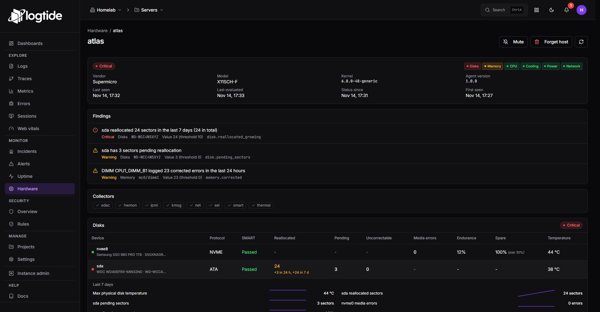

# LogTide hardware agent

[](https://github.com/logtide-dev/logtide-hw-agent/actions/workflows/ci.yml)
[](LICENSE)

Reads hardware health signals from a physical host and sends them to LogTide:
SMART (HDD, SSD, NVMe), ECC memory errors (EDAC), temperatures, fans and
voltages (hwmon, IPMI), CPU thermal throttling, physical NIC counters, kernel
hardware errors (`/dev/kmsg`) and the BMC event log. It also reports host resource
usage (CPU, load, memory, swap, filesystems, disk and network throughput, uptime) with
OpenTelemetry `system.*` names. Metrics go to
`/v1/otlp/metrics`, events to `/api/v1/ingest` (service `hardware`).

Single Python file, standard library only (Python 3.8+). It runs as root because
SMART, `/dev/kmsg` and IPMI need raw device access. On a VM most sensors do not
exist; the agent reports that the host is virtual and the collectors that find
nothing report status 0.



## Compatibility

Requires LogTide 1.7.0 or later (the Monitor > Hardware section and the `hw.*`
metric contract). Hosted LogTide Cloud is supported: point `LOGTIDE_URL` at
`https://api.logtide.dev`. The metrics, attributes and health rules are documented at
[logtide.dev/docs/hardware-health](https://logtide.dev/docs/hardware-health).

The agent follows semantic versioning independently of LogTide. A change to the
metric contract that older LogTide versions cannot read is a major version.

## Run with Docker

```bash
docker run -d --name logtide-hw-agent --restart unless-stopped --privileged \
  -e LOGTIDE_URL=https://api.logtide.dev \
  -e LOGTIDE_API_KEY=lp_your_key \
  -e HOST_ROOT=/host \
  -v /sys:/host/sys:ro \
  -v /proc:/host/proc:ro \
  -v /etc/hostname:/host/etc/hostname:ro \
  -v logtide-hw-agent-state:/var/lib/logtide-hw-agent \
  logtide/hw-agent:latest
```

Check it works before leaving it running (prints the payloads, sends nothing):

```bash
docker run --rm --privileged -e HOST_ROOT=/host -e LOGTIDE_HW_DRY_RUN=1 \
  -v /sys:/host/sys:ro -v /proc:/host/proc:ro -v /etc/hostname:/host/etc/hostname:ro \
  logtide/hw-agent:latest --once
```

Why these mounts:

- `/sys` and `/proc` are mounted under `/host` and read through `HOST_ROOT`. The
  container's own `/sys/class/net` only shows the container's network namespace,
  so NIC counters would be wrong without the host mount.
- `--privileged` gives the container the host `/dev` (SATA/NVMe disks,
  `/dev/kmsg`, `/dev/ipmi0`) and the capabilities smartctl needs.
- The `/etc/hostname` mount makes the host name match the real host instead of the
  container id. Alternatively set `LOGTIDE_HOSTNAME`.
- The state volume keeps the BMC event log position across restarts.
- Optional, for filesystem usage: add `-v /:/host:ro,rslave` (it replaces the separate
  `/sys`, `/proc` and `/etc/hostname` mounts, which are then already under `/host`). The
  agent measures the host mounts through `HOST_ROOT`. Without it the container cannot see
  the host filesystems, so `system.filesystem.*` is left out (the other `system.*` metrics
  still describe the host). The agent never reports the container's own filesystem as the
  host's.

Without `--privileged` you need `--cap-add SYS_RAWIO --cap-add SYS_ADMIN
--cap-add SYSLOG` plus one `--device` per disk (`/dev/sda`, `/dev/nvme0`...),
`--device /dev/kmsg` and `--device /dev/ipmi0` if present. This is more fragile
(seccomp and AppArmor profiles vary) and privileged is the tested path.

With the LogTide compose stack: `docker compose --profile hardware up -d`
(see `docker/docker-compose.yml` in the [LogTide repository](https://github.com/logtide-dev/logtide)).

## Run with systemd

```bash
sudo apt install -y python3 smartmontools ipmitool   # ipmitool only on servers with a BMC
sudo install -d /opt/logtide-hw-agent /etc/logtide
sudo curl -fsSL https://raw.githubusercontent.com/logtide-dev/logtide-hw-agent/main/logtide_hw_agent.py \
  -o /opt/logtide-hw-agent/logtide_hw_agent.py
sudo curl -fsSL https://raw.githubusercontent.com/logtide-dev/logtide-hw-agent/main/logtide-hw-agent.service \
  -o /etc/systemd/system/logtide-hw-agent.service
sudo tee /etc/logtide/hw-agent.env >/dev/null <<'ENV'
LOGTIDE_URL=https://api.logtide.dev
LOGTIDE_API_KEY=lp_your_key
ENV
sudo chmod 600 /etc/logtide/hw-agent.env
sudo systemctl daemon-reload
sudo systemctl enable --now logtide-hw-agent
```

Verify once in the foreground, then follow the service log:

```bash
sudo sh -c 'set -a; . /etc/logtide/hw-agent.env; LOGTIDE_HW_DRY_RUN=1 python3 /opt/logtide-hw-agent/logtide_hw_agent.py --once'
journalctl -u logtide-hw-agent -f
```

## Configuration

| Variable | Default | Description |
|---|---|---|
| `LOGTIDE_URL` | required | Base URL of the LogTide API, e.g. `http://backend:8080` |
| `LOGTIDE_API_KEY` | required | Project API key, sent as `X-API-Key` |
| `LOGTIDE_HOSTNAME` | `${HOST_ROOT}/etc/hostname`, else the system hostname | Value of `host.name` |
| `HOST_ROOT` | empty | Prefix for `/sys`, `/proc` and `/etc` reads (`/host` in the container) |
| `LOGTIDE_HW_INTERVAL` | `60` | Seconds between collections (minimum 5) |
| `LOGTIDE_HW_COLLECTORS` | all | Comma list of `smart,edac,hwmon,thermal,ipmi,sel,net,system,kmsg` |
| `LOGTIDE_HW_STATE_DIR` | `/var/lib/logtide-hw-agent` | Where the last BMC event id is stored |
| `LOGTIDE_HW_DRY_RUN` | off | `1` prints payloads to stdout instead of sending |
| `LOGTIDE_HW_KMSG_PATH` | `/dev/kmsg` | Kernel log device (testing) |

Collectors are enabled by default. Set `LOGTIDE_HW_COLLECTORS` to the ones you want to
keep, for example `LOGTIDE_HW_COLLECTORS=smart,edac,hwmon,thermal,ipmi,sel,net,kmsg` turns
the `system` collector off (a hardware-only agent), and `LOGTIDE_HW_COLLECTORS=system`
runs only the resource metrics. An explicit list written for 1.0.x does not contain
`system`, so upgrading such an agent does not start sending resource metrics until you add it.

`--once` runs one collection, sends it and exits (exit code 1 if delivery failed).

## System metrics

The `system` collector reads `/proc` and `statvfs` (through `HOST_ROOT`, using
`/proc/1/mounts` and `/proc/1/net/dev` in a container so it sees the host and not the
container namespace). Like the `hw.*` metrics they are sent as OTLP gauges with
`service.name=logtide-hw-agent`, `host.name`, and the `hw.type` (`system`) and `hw.id`
attributes. Counters (disk and network) are sent as per-second rates computed between two
cycles, so they chart directly; the first cycle after a start sends no rates and a counter
that goes backwards (reboot, wrap) skips one cycle.

| Metric | Unit | Attributes | Source |
|---|---|---|---|
| `system.cpu.utilization` | % (0-100) | `system.cpu.state` = `user`, `system`, `iowait`, `steal`, `idle` (they add up to 1) | `/proc/stat` deltas |
| `system.cpu.utilization.total` | % | none | busy share: `1 - idle - iowait` |
| `system.cpu.load_average.1m`, `.5m`, `.15m` | 1 | none | `/proc/loadavg` |
| `system.memory.usage` | By | `system.memory.state` = `used` (total minus `MemAvailable`), `free`, `cached` (page cache plus reclaimable slab), `buffers` | `/proc/meminfo` |
| `system.memory.utilization` | % | none | used / total |
| `system.paging.usage` | By | `system.paging.state` = `used`, `free` | swap; nothing is sent without swap |
| `system.paging.utilization` | % | none | swap used / total |
| `system.filesystem.usage` | By | `system.device`, `system.filesystem.mountpoint`, `system.filesystem.type`, `system.filesystem.state` = `used`, `free` (available to unprivileged users, like `df`) | `/proc/mounts` + `statvfs` |
| `system.filesystem.utilization` | % | `system.device`, `system.filesystem.mountpoint`, `system.filesystem.type` | used / (used + free), like `df` |
| `system.disk.io.rate` | By/s | `system.device`, `disk.io.direction` = `read`, `write` | `/proc/diskstats` deltas |
| `system.disk.operations.rate` | {operation}/s | `system.device`, `disk.io.direction` | `/proc/diskstats` deltas |
| `system.network.io.rate` | By/s | `system.device`, `network.io.direction` = `receive`, `transmit` | `/proc/net/dev` deltas |
| `system.uptime` | s | none | `/proc/uptime` |

Utilization metrics are percentages from 0 to 100, not the 0-1 ratios of the OpenTelemetry
specification: the LogTide Metrics page formats `*.utilization` values as percent.

Filesystems: pseudo and virtual types (proc, sysfs, tmpfs, overlay, devtmpfs, cgroup,
squashfs, ...) are skipped and a device mounted in several places is reported once, under
its first mountpoint. Disks: whole disks only (`sd*`, `vd*`, `xvd*`, `hd*`, `nvme*n*`,
`mmcblk*`, `md*`); partitions, loop, ram and device-mapper devices are skipped. Network:
every interface except `lo` and `veth*`.

## Troubleshooting

- **Collector status 0.** `hw.agent.collector.status` is 0 for a collector whose source is
  absent (no `ipmitool`, no `/dev/ipmi0`, no EDAC on the CPU) or that failed. A single slow
  cycle does not flip it: a collector that only runs out of time keeps its previous status
  and reports 0 after a second timeout in a row.
- **Slow or dying disks.** Every `smartctl` call is limited to 15 s and the SMART collector
  to 45 s in total (IPMI 30 s). SMART runs in its own thread, so the other collectors still
  report every cycle. A `smartctl` that survives SIGKILL (a disk hung in D-state) is
  abandoned and logged, and that device is skipped until the process exits.
- **Clock skew.** The agent compares its clock with the `Date` header of every successful
  response. If it differs by more than 5 minutes it logs a warning (at most once an hour).
  Data is still sent with the local timestamps, so fix NTP on the host: points with a wrong
  time land outside the time window you are looking at, or are rejected as too old or in
  the future.
- **Nothing arrives.** Run the `--once` command with `LOGTIDE_HW_DRY_RUN` removed: it exits
  with code 1 and logs the HTTP status when delivery fails (401 means a wrong API key).

## Tests

```bash
python -m unittest discover -s tests
```
